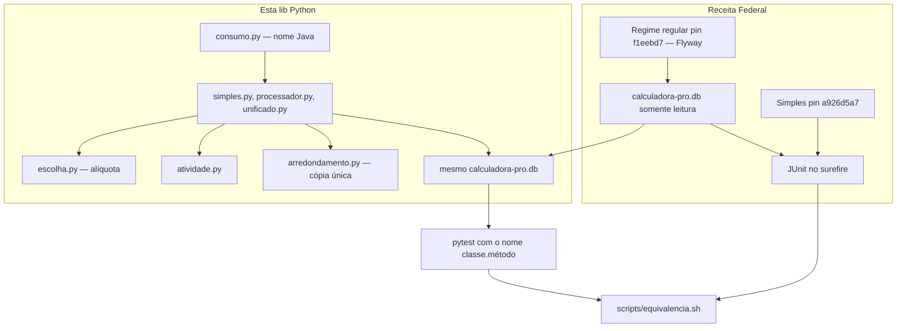

# calculadora-rtc-simples-nacional

Cálculo de CBS e IBS do Simples Nacional, em Python. É uma implementação independente da calculadora Java que a Receita Federal publicou em código aberto, conferida contra a suíte de testes daquele projeto no commit pinado. Não é um fork: o código Java não entra neste repositório.

Não é projeto oficial, produto homologado, certificado ou mantido pela Receita Federal do Brasil nem pelo Serpro. Não é parecer, orientação ou consultoria tributária. A suíte do pin não cobre cenário que ela não executa e não substitui a legislação.

**Nossas** (esta implementação em Python, MIT, Copyright (c) 2026 Garuso Cruz)

[](https://pypi.org/project/calculadora-rtc-simples-nacional/)
[](LICENSE)
[](#ultima-validacao)
[](cloudbuild.yaml)

**Do pin oficial** (calculadora Java do Simples, commit `a926d5a7`, e Flyway do regime regular, commit `f1eebd7`; as duas obras são MIT, Copyright (c) 2026 Receita Federal do Brasil)

[](https://github.com/ReceitaFederal/calculadora-rtc-simples-nacional/commit/a926d5a76095ac0295a6612a9a54db7ffead2396)
[](LICENSE-RECEITA.md)
[](#ultima-validacao)

As duas coberturas medem unidades diferentes: a nossa conta sentenças Python (mínimo 80%) e a do pin conta linhas Java no JaCoCo (mínimo oficial 80%). O detalhe está em [Última validação](#ultima-validacao).

| | |
| --- | --- |
| Fonte oficial | [ReceitaFederal/calculadora-rtc-simples-nacional](https://github.com/ReceitaFederal/calculadora-rtc-simples-nacional) |
| Commit pinado | [`a926d5a76095ac0295a6612a9a54db7ffead2396`](https://github.com/ReceitaFederal/calculadora-rtc-simples-nacional/commit/a926d5a76095ac0295a6612a9a54db7ffead2396) |
| Versão oficial do pin | CalculadorTributo `1.0.2`, commit de 2026-11-20 |
| Versão oficial do Flyway | CalculadorTributo `1.7.2` do regime regular, commit de 2026-11-19 |
| Flyway do pin | [regime regular `f1eebd7ce3157423b1a6aaca7dc1d6c3395452c4`](https://github.com/ReceitaFederal/calculadora-rtc-regime-regular/commit/f1eebd7ce3157423b1a6aaca7dc1d6c3395452c4) |
| Licenças | [LICENSE](LICENSE) (nossa) e [LICENSE-RECEITA.md](LICENSE-RECEITA.md) (Receita, sobre o Java do pin e o Flyway) |

## Índice

- [Limite de uso](#limite)
- [Arquitetura](#arquitetura)
- [Equivalência](#equivalencia)
- [Última validação](#ultima-validacao)
- [Atualização do pin](#atualizacao-do-pin)
- [Instalação](#instalacao)
- [Consumo](#consumo)
- [Licença](#licenca)

## Fora do escopo

A lib não sobe API, não emite nota, não assina XML e não chama a Sefin. O controller, o MockMvc e o HTTP 400 ficam no Java. Quem consome chama o serviço, com o mesmo nome de método da classe Java, em `calculadora_rtc_simples_nacional.consumo`. O índice público do PyPI tem a `0.4.1`. O número deste repositório não vira release no GitHub.

O banco é o `calculadora-pro.db` do regime regular, gerado pelo Flyway de https://github.com/ReceitaFederal/calculadora-rtc-regime-regular no pin `f1eebd7`. A política numérica é o mesmo `arredondamento.py` das duas libs, byte a byte.

<a id="limite"></a>

## Limite de uso

O cálculo do item recebe as alíquotas efetivas já resolvidas (`pIBSSN` e `pCBSSN`), como o `SimplesNacionalCalculoService` do pin. Esta lib não apura a alíquota efetiva do Simples a partir da receita bruta do contribuinte.

O resultado depende do insumo, do `calculadora-pro.db` daquele pin e da cobertura da suíte. Uso em documento fiscal exige conferência independente. A publicação do código pela Receita não homologa esta implementação.

Só `arredondamento.py` quantiza, na política do pin. O texto JSON entra com `Decimal`. A conta não usa `float`. A comparação com o Java vale para os casos da suíte daquele commit, não para cenário que ela não executa.

| O que | Nesta versão |
| --- | --- |
| Casos da suíte Java do pin | comparados; ver [Última validação](#ultima-validacao) |
| Alíquota efetiva a partir da receita bruta | não; entra pronta em `pIBSSN` e `pCBSSN` |
| Arredondamento | só `arredondamento.py`, conferido contra o pin |
| API, nota, XML e HTTP | não |
| DANFSe | não |
| Parecer ou enquadramento tributário | não |

O DANFSe também fica de fora. O PDF da NFS-e é o módulo Go `danfse-service`, em https://github.com/ReceitaFederal/calculadora-rtc-gerador-danfse, pin `8d79e6b2f7fad6375340afcb51c85ed370c64a14`.

<a id="arquitetura"></a>

## Arquitetura



A escolha da alíquota não importa o cálculo. A atividade não importa a escolha da alíquota. O cálculo usa os dois. Só `arredondamento.py` chama `quantize`.

A lib abre o SQLite em modo somente leitura. O caminho entra por `CALC_DB`. Sem a variável, ela procura `calculadora/db/calculadora-pro.db` a partir do diretório corrente.

<a id="equivalencia"></a>

## Equivalência

O gancho `scripts/hooks/pre-push.sh` chama `scripts/equivalencia.sh`. O CI é o Cloud Build, sem workflow do GitHub Actions. A pull request dispara `calculadora-rtc-simples-nacional-pr` e não publica. O push na `main` dispara `calculadora-rtc-simples-nacional-main`. Depois do quality gate, o mesmo run faz o build da lib, grava o README com esse build e com esse run, publica no PyPI, abre a tag `vX.Y.Z` e abre a pull request que devolve o README para a `main`. O merge dessa pull request vê a versão já publicada e não repete o build.

<!-- release-runs:start -->
Release `v0.4.0` em 2026-11-23. Build [`6c0675df-e8cd-4b7a-b35b-500917e0b8ff`](https://console.cloud.google.com/cloud-build/builds;region=us-central1/6c0675df-e8cd-4b7a-b35b-500917e0b8ff?project=lynko-508200) no commit `f113e71c5117e44c01af57fd56212ae65d78d1d8`.
<!-- release-runs:end -->

A tag `vX.Y.Z` dispara `calculadora-rtc-simples-nacional-release`. Esse passo não publica de novo: confere o README e que o PyPI já tem a versão gravada no bloco acima.

```bash
export PATH="${HOME}/.local/bin:${HOME}/.asdf/shims:${PATH}"
cd libs/calculadora-rtc-simples-nacional
bash scripts/hooks/pre-push.sh
```

O script baixa o Simples no pin `a926d5a7` e o Flyway do regime regular no pin `f1eebd7`. Só imprime `pre-push OK` quando todas as linhas abaixo passam.

| Gate | O que confere | Falha se |
| --- | --- | --- |
| Java 25 | `java -version` começa em 25 | a máquina está em outra versão |
| Pins | Simples `a926d5a7` e Flyway `f1eebd7` | um dos checkouts não chega no commit |
| Flyway | `./mvnw flyway:migrate` com o `flyway-pro.conf` do regime regular | `calculadora-pro.db` não aparece |
| Surefire | `./mvnw test` no Java oficial do Simples | algum teste Java falha |
| Pytest | `python3 -m pytest` com cobertura mínima de 80% | a suíte Python falha ou a cobertura fica abaixo |
| Nome e resultado | cada caso Java do corte tem o mesmo `classe.método` e o mesmo estado no JUnit Python | falta nome ou o estado diverge |

O corte deixa de fora o que é HTTP: classe ou pacote com `Controller`, método `teste_controller*` e nome com `retorna400`. Entram a arquitetura do arredondamento, a cópia única desse arquivo e o sentido das dependências do núcleo (`Teste_DependenciasNucleo`).

O pytest grava `junit_family = legacy` para o `classname` e o `name` saírem iguais aos do surefire, inclusive no caso parametrizado `método(Tipo)[n]`.

<a id="ultima-validacao"></a>

## Última validação

Data: 22 de novembro de 2026. Os números abaixo são do `scripts/hooks/pre-push.sh` local, que terminou em `pre-push OK`. O Cloud Build repete esses gates na pull request e na `main`.

| Checagem | Saída |
| --- | --- |
| Maven test | a suíte Java do pin passou |
| Pytest | 481 passaram, 10,02 s |
| Cobertura Python | 94,94% de 2490 sentenças. O mínimo desta lib é 80% |
| Cobertura Java do pin | 90,56% de 1853 linhas (1678 cobertas). JaCoCo do `mvn test` daquele commit, sem a classe `*Application`, como no `pom.xml` oficial. O workflow oficial exige 80% de linhas |
| Java no corte daquele momento | 180 unitários, 32 e2e |
| Python no relatório | 953 chaves |
| Sem par | 0 |
| Resultado diferente | 0 |
| Frase final | `Equivalência: a mesma suíte passou nas duas.` |

Depois desse log, arquitetura e dependências do núcleo passaram a contar no corte. A comparação seguinte usou o surefire já gerado e um pytest novo, sem repetir o Maven: 218 casos Java, 0 sem par, 0 com resultado diferente. Esse pytest teve 487 testes passando.

<a id="atualizacao-do-pin"></a>

## Atualização do pin

A Receita não aceita pull request externo. O acompanhamento é a inscrição no repositório oficial, em Watch, com Issues, Releases e Security alerts. Pull requests e Discussions ficam desligados. O mesmo vale para o regime regular, porque o Flyway e o `arredondamento.py` vêm de lá.

Os três pins oficiais (regime regular, Simples e DANFSe) estão em `lynko-workspace/initiatives/faturae/receita-rtc-pins.json`, no repositório interno da Lynko. O Simples é o padrão `OFICIAL_SHA` de `scripts/equivalencia.sh`. O Flyway é `FLYWAY_SHA`.

Quando sai um release, um alerta de segurança ou uma issue que muda regra:

1. Ler o commit novo no repositório oficial.
2. Trocar o pin no script e no JSON de pins. Se o Flyway mudou, trocar também `FLYWAY_SHA`.
3. Rodar `bash scripts/hooks/pre-push.sh`.
4. Cada nome que faltar é um serviço que o controller Java chama. Portar esse serviço. A fachada em `consumo.py` conserva a classe e o método Java. Por dentro, a função nova fica em snake_case.
5. Se `arredondamento.py` mudar, a mesma alteração entra nas duas libs e o SHA-256 dos testes de cópia única é atualizado nos dois lados.
6. Repetir o gancho até `pre-push OK`.
7. Gravar o número novo no `pyproject.toml` e abrir a pull request para `main`. O merge, no mesmo run, faz o build, grava o README, publica no PyPI, abre a tag e abre a pull request que devolve o README para a `main`.

Não se recoloca esse cálculo em `backends/faturae`. Não se publica no Artifact Registry. Não se publica pacote de rc.

<a id="instalacao"></a>

## Instalação

Python 3.12 ou superior. Não há dependência de runtime além da biblioteca padrão. O pacote público no PyPI é a `0.3.1`.

```bash
pip install calculadora-rtc-simples-nacional
```

Para desenvolver a partir do clone:

```bash
cd libs/calculadora-rtc-simples-nacional
./install.sh
```

O script cria o `.venv` na raiz (`cenv` se existir, senão `python3 -m venv`), ativa esse ambiente, roda `poetry install --with dev` e, no clone git, registra pre-commit, pre-push e commit-msg. Em outro shell: `source .venv/bin/activate`.

O `calculadora-pro.db` é gerado pelo gancho, com o Flyway do regime regular, em `.cache/oficial/java/calculadora/db/calculadora-pro.db`.

```bash
export CALC_DB="$PWD/.cache/oficial/java/calculadora/db/calculadora-pro.db"
```

<a id="consumo"></a>

## Consumo

Importe a fachada. O cálculo do item recebe regime, tipo de receita e alíquotas já resolvidos. A lib não escolhe o anexo no lugar de quem chama, salvo pelos serviços que já fazem essa resolução (`EscolhaParAliquotasService`, `AtividadeSimplesService`).

```python
import os
from decimal import Decimal

os.environ["CALC_DB"] = "/caminho/calculadora-pro.db"

from calculadora_rtc_simples_nacional.consumo import SimplesNacionalCalculoService
from calculadora_rtc_simples_nacional.simples import Destino, Insumo, Regime, TipoReceita

regime = Regime("SN_PLENO", True, "CRT 1", True, Destino.DEVIDO, Destino.PENDENTE_SUSPENSO)
tipo = TipoReceita(1, "Receita bruta - interna", True, Decimal("1.0"), False, False, True, True)
insumo = Insumo(regime, tipo, None, Decimal("1000.00"), Decimal("0"), Decimal("0.10"), Decimal("0.90"), None, None)
resultado = SimplesNacionalCalculoService().calcularItem(insumo)
```

Fachada em `consumo.py`:

| Classe | Método de entrada |
| --- | --- |
| `SimplesNacionalCalculoService` | `calcularItem` |
| `SimplesNacionalObservabilidadeService` | `processarOperacao` |
| `SimplesNacionalNaoAssistidoService` | `processarOperacao` |
| `EscolhaParAliquotasService` | `escolher` |
| `AtividadeSimplesService` | `listar`, `buscarPorCodigo`, `derivar` |
| `ValidacaoNomenclaturaService` | `validar` |
| `VersaoOfflineService` | `verificarVersao`, `verificarVersaoNaInicializacao` |

`VersaoOfflineService` consulta a instalação online indicada por quem chama. Não abre porta local. Consulta que lê o banco precisa de `CALC_DB`.

<a id="licenca"></a>

## Licença

O código Java oficial não é copiado para este git. A licença dele vale para a obra da Receita e fica reproduzida aqui para o aviso de copyright.

| Obra | Licença | Arquivo |
| --- | --- | --- |
| Esta implementação em Python | MIT, Copyright (c) 2026 Garuso Cruz | [LICENSE](LICENSE) |
| Calculadora Java do Simples, commit `a926d5a76095ac0295a6612a9a54db7ffead2396` | MIT, Copyright (c) 2026 Receita Federal do Brasil | [LICENSE-RECEITA.md](LICENSE-RECEITA.md) |
| Flyway e banco do regime regular, commit `f1eebd7ce3157423b1a6aaca7dc1d6c3395452c4` | MIT, Copyright (c) 2026 Receita Federal do Brasil | [LICENSE-RECEITA.md](LICENSE-RECEITA.md) |

O texto MIT da Receita exige que o aviso de copyright e a permissão acompanhem cópias substanciais daquela obra. Esta implementação conserva esse aviso. A licença desta lib continua sendo a MIT de Garuso Cruz. A MIT da Receita não transfere a titularidade do código dela.
