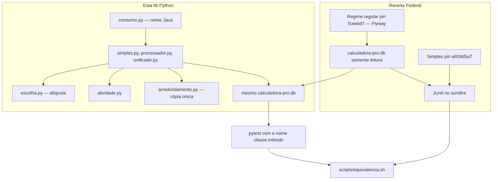

# calculadora-rtc-simples-nacional

Cálculo genérico de CBS e IBS do Simples Nacional, em Python.

É a transcrição da calculadora pública da Receita Federal no commit `a926d5a76095ac0295a6612a9a54db7ffead2396`. A fonte oficial é https://github.com/ReceitaFederal/calculadora-rtc-simples-nacional. Licença MIT. Esta biblioteca não emite nota, não assina XML e não chama a Sefin.

A lib não sobe API. O controller, o MockMvc e o HTTP 400 ficam no Java. Quem consome chama o serviço, com o mesmo nome de método da classe Java, em `calculadora_rtc_simples_nacional.consumo`.

O banco é o `calculadora-pro.db` do regime regular. O Flyway que o gera está em https://github.com/ReceitaFederal/calculadora-rtc-regime-regular, pin `f1eebd7ce3157423b1a6aaca7dc1d6c3395452c4`. A política numérica é o mesmo `arredondamento.py` das duas libs, byte a byte.

O DANFSe não faz parte deste repositório nem do Java do Simples. O PDF da NFS-e é o módulo Go `danfse-service`, em https://github.com/ReceitaFederal/calculadora-rtc-gerador-danfse, pin `8d79e6b2f7fad6375340afcb51c85ed370c64a14`.

## Arquitetura



A escolha da alíquota não importa o cálculo. A atividade não importa a escolha da alíquota. O cálculo usa os dois. Só `arredondamento.py` chama `quantize`.

A lib abre o SQLite em modo somente leitura. O caminho entra por `CALC_DB`. Sem a variável, ela procura `calculadora/db/calculadora-pro.db` a partir do diretório corrente.

## Equivalência

O gancho `scripts/hooks/pre-push.sh` chama `scripts/equivalencia.sh`. O Cloud Build dispara o mesmo script pelo arquivo `cloudbuild.yaml`. Os triggers, no plano de delivery da fundação, são `calculadora-rtc-simples-nacional-pr` (pull request para `main`) e `calculadora-rtc-simples-nacional-main` (push em `main`). Não há workflow do GitHub Actions. O build não publica pacote.

```bash
export PATH="${HOME}/.local/bin:${HOME}/.asdf/shims:${PATH}"
cd libs/calculadora-rtc-simples-nacional
bash scripts/hooks/pre-push.sh
```

O script baixa o Simples no pin `a926d5a7` e o Flyway do regime regular no pin `f1eebd7`. Só imprime `pre-push OK` quando todas as linhas abaixo passam.

| Gate | O que confere | Falha se |
| --- | --- | --- |
| Java 25 | `java -version` começa em 25 | a máquina está em outra versão |
| Pins | Simples `a926d5a7` e Flyway `f1eebd7` | um dos checkouts não chega no commit |
| Flyway | `./mvnw flyway:migrate` com o `flyway-pro.conf` do regime regular | `calculadora-pro.db` não aparece |
| Surefire | `./mvnw test` no Java oficial do Simples | algum teste Java falha |
| Pytest | `python3 -m pytest` com cobertura mínima de 80% | a suíte Python falha ou a cobertura fica abaixo |
| Nome e resultado | cada caso Java do corte tem o mesmo `classe.método` e o mesmo estado no JUnit Python | falta nome ou o estado diverge |

O corte deixa de fora o que é HTTP: classe ou pacote com `Controller`, método `teste_controller*` e nome com `retorna400`. Entram a arquitetura do arredondamento, a cópia única desse arquivo e o sentido das dependências do núcleo (`Teste_DependenciasNucleo`).

O pytest grava `junit_family = legacy` para o `classname` e o `name` saírem iguais aos do surefire, inclusive no caso parametrizado `método(Tipo)[n]`.

## Última validação

Data: 22 de novembro de 2026. O check remoto ainda é o script local. O Cloud Build passa a gravar o status quando o plano de delivery estiver aplicado e o repositório `garusocruz/calculadora-rtc-simples-nacional` existir.

O `scripts/hooks/pre-push.sh` completo, log em `.cache/pre-push.log`, terminou `pre-push OK`.

| Checagem | Saída |
| --- | --- |
| Maven test | a suíte Java do pin passou |
| Pytest | 481 passaram, 10,02 s |
| Cobertura | 94,94% de 2489 sentenças. O mínimo é 80% |
| Java no corte daquele momento | 180 unitários, 32 e2e |
| Python no relatório | 953 chaves |
| Sem par | 0 |
| Resultado diferente | 0 |
| Frase final | `Equivalência: a mesma suíte passou nas duas.` |

Depois desse log, arquitetura e dependências do núcleo passaram a contar no corte. A comparação seguinte usou o surefire já gerado e um pytest novo, sem repetir o Maven: 218 casos Java, 0 sem par, 0 com resultado diferente. Esse pytest teve 487 passaram.

## Atualização do pin

A Receita não aceita pull request externo. O acompanhamento é a inscrição no repositório oficial, em Watch, com Issues, Releases e Security alerts. Pull requests e Discussions ficam desligados. O mesmo vale para o regime regular, porque o Flyway e o `arredondamento.py` vêm de lá.

Os três pins oficiais estão em `lynko-workspace/initiatives/faturae/receita-rtc-pins.json`. O Simples é o padrão `OFICIAL_SHA` de `scripts/equivalencia.sh`. O Flyway é `FLYWAY_SHA`.

Quando sai um release, um alerta de segurança ou uma issue que muda regra:

1. Ler o commit novo no repositório oficial.
2. Trocar o pin no script e no JSON de pins. Se o Flyway mudou, trocar também `FLYWAY_SHA`.
3. Rodar `bash scripts/hooks/pre-push.sh`.
4. Cada nome que faltar é um serviço que o controller Java chama. Portar esse serviço. A fachada em `consumo.py` conserva a classe e o método Java. Por dentro, a função nova fica em snake_case.
5. Se `arredondamento.py` mudar, a mesma alteração entra nas duas libs e o SHA-256 dos testes de cópia única é atualizado nos dois lados.
6. Repetir o gancho até `pre-push OK`.

Não se recoloca esse cálculo em `backends/faturae`. Não se publica em Artifact Registry nem em Cloud Build da Lynko.

## Instalação

Python 3.12 ou superior. Não há dependência de runtime além da biblioteca padrão.

```bash
cd libs/calculadora-rtc-simples-nacional
poetry install
```

O `calculadora-pro.db` é gerado pelo gancho, com o Flyway do regime regular, em `.cache/oficial/java/calculadora/db/calculadora-pro.db`.

```bash
export CALC_DB="$PWD/.cache/oficial/java/calculadora/db/calculadora-pro.db"
```

## Consumo

Importe a fachada. O cálculo do item recebe regime, tipo de receita e alíquotas já resolvidos. A lib não escolhe o anexo no lugar de quem chama, salvo pelos serviços que já fazem essa resolução (`EscolhaParAliquotasService`, `AtividadeSimplesService`).

```python
import os
from decimal import Decimal

os.environ["CALC_DB"] = "/caminho/calculadora-pro.db"

from calculadora_rtc_simples_nacional.consumo import SimplesNacionalCalculoService
from calculadora_rtc_simples_nacional.simples import Destino, Insumo, Regime, TipoReceita

regime = Regime("SN_PLENO", True, "CRT 1", True, Destino.DEVIDO, Destino.PENDENTE_SUSPENSO)
tipo = TipoReceita(1, "Receita bruta - interna", True, Decimal("1.0"), False, False, True, True)
insumo = Insumo(regime, tipo, None, Decimal("1000.00"), Decimal("0"), Decimal("0.10"), Decimal("0.90"), None, None)
resultado = SimplesNacionalCalculoService().calcularItem(insumo)
```

Fachada em `consumo.py`:

| Classe | Método de entrada |
| --- | --- |
| `SimplesNacionalCalculoService` | `calcularItem` |
| `SimplesNacionalObservabilidadeService` | `processarOperacao` |
| `SimplesNacionalNaoAssistidoService` | `processarOperacao` |
| `EscolhaParAliquotasService` | `escolher` |
| `AtividadeSimplesService` | `listar`, `buscarPorCodigo`, `derivar` |
| `ValidacaoNomenclaturaService` | `validar` |
| `VersaoOfflineService` | `verificarVersao`, `verificarVersaoNaInicializacao` |

`VersaoOfflineService` consulta a instalação online indicada por quem chama. Não abre porta local. Consulta que lê o banco precisa de `CALC_DB`.
