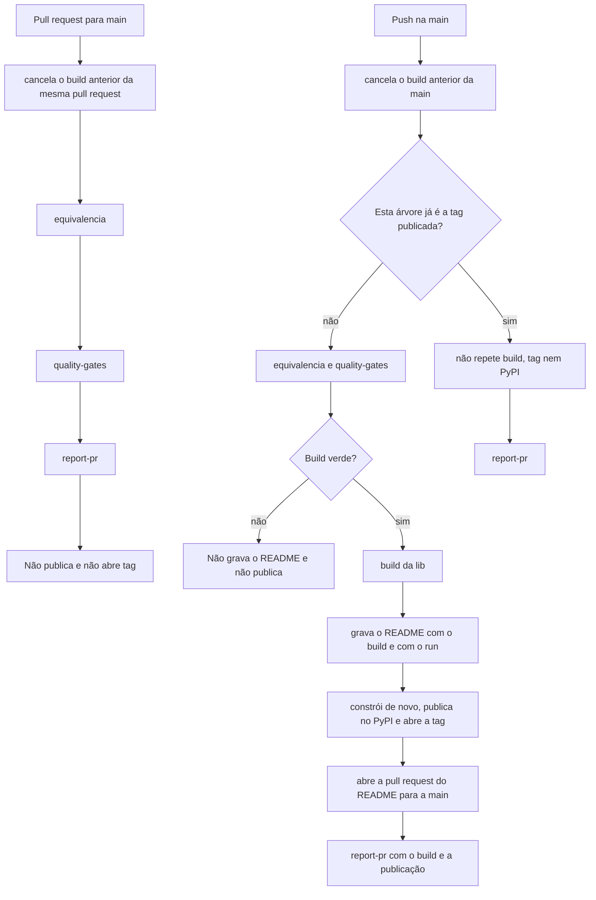
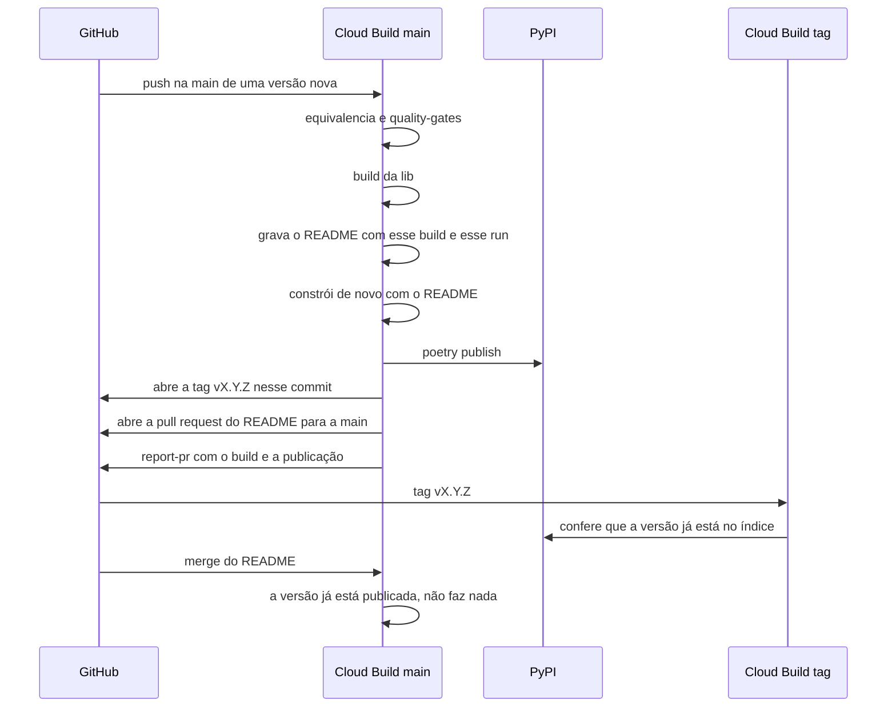
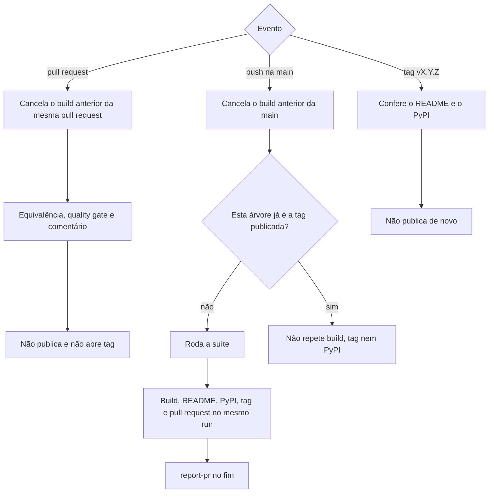

# Publicação da calculadora do Simples Nacional

Escopo: o push na `main` de uma versão que ainda não está no PyPI passa pelo quality gate e, no mesmo run, faz o build da lib, grava o README com os insumos desse build e desse run, constrói de novo, publica no PyPI, abre a tag `vX.Y.Z` e abre a pull request do README para a `main`. O merge seguinte encontra a versão no PyPI e na tag e não repete o build, a tag nem o PyPI. O trigger da tag não publica. Não sobe para o Artifact Registry.

## Fluxograma

## Sequência

## Decisão

Um commit novo na mesma pull request ou na `main` cancela o Cloud Build anterior. A tag não cancela. No build da `main` o passo de cancelamento recebe o ambiente `main`, porque `production` faria o script pular. O restante do build da `main` continua com o rótulo `production` para o comentário da pull request.

O README que entra na tag e no PyPI é o gravado depois do quality gate, no mesmo run. A tag aponta para o commit desse README, não para o merge que ainda não o tinha. A pull request só devolve esse README para a `main`. Se o push chega com a mesma árvore da tag, a suíte não roda. Se a versão já está no PyPI e a árvore mudou, a suíte roda e não abre outra tag. Sem a frase `o run que validou esta versão`, a tag não abre e o PyPI não recebe o pacote.

O passo `report-pr` fecha a esteira da `main`, depois da publicação. O comentário lê o secret `lynko-github-ci-token`. A tag, a pull request do README e o comentário precisam de Contents: Write e Issues: Write nesse token.
