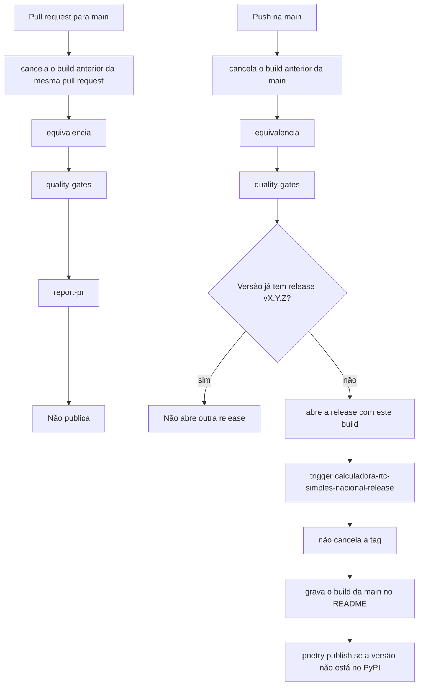
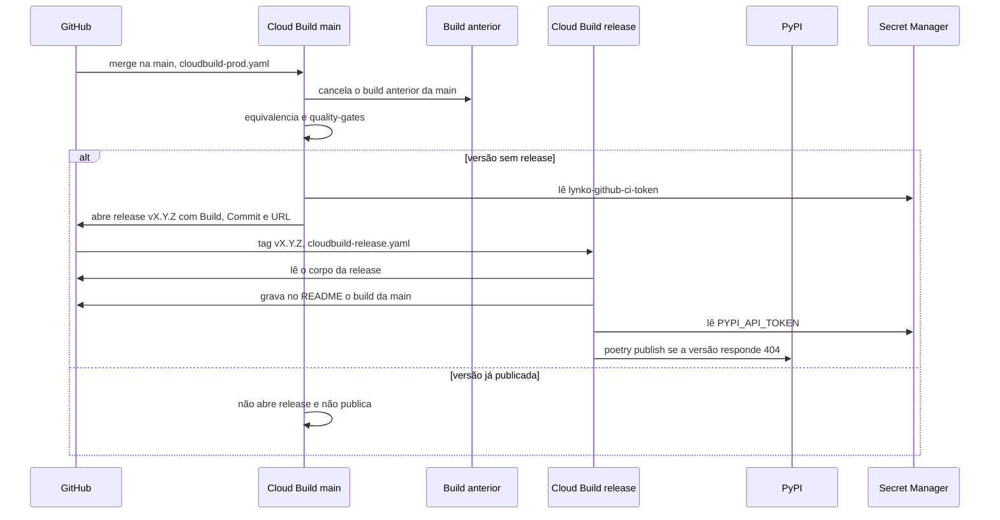
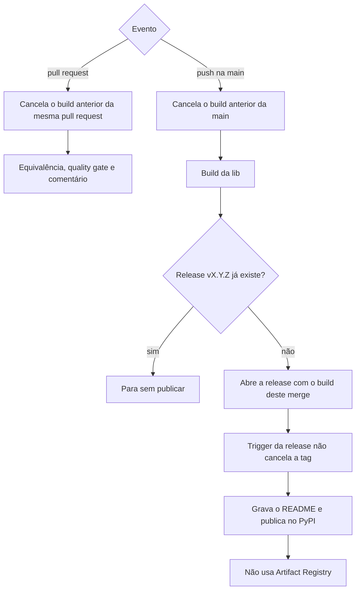

# Publicação da calculadora do Simples Nacional

Escopo: o push da `main` faz o build da lib. Se a versão ainda não tem release, esse build abre `vX.Y.Z` e guarda o próprio run. O trigger da release grava esse run no README e publica no PyPI, sem refazer o build. Não sobe para o Artifact Registry.

## Fluxograma

## Sequência

## Decisão

O script é o das libs Lynko. Ele pula quando o ambiente é `production`. Por isso o passo da `main` recebe `main`, e o da tag recebe `production`. O restante do build da `main` continua com o rótulo `production` para o comentário da pull request. A release grava as notas da versão, no `CHANGELOG.md`, e o mesmo comentário que o build publica na pull request. As linhas `Build`, `Commit` e `URL` ficam no fim do corpo. O README dessa versão abre uma pull request para a `main`. O trigger não escreve direto na `main`.

O passo `report-pr` está no `cloudbuild.yaml`. A imagem `cloud-sdk:slim` não traz `python3`, então o passo instala. O comentário lê o secret `lynko-github-ci-token`. No build `734e3d4d` o script não achou o `python3` e o GitHub respondeu 403. Sem Issues: Write neste repositório, o passo não comenta e o `pipeline-gate` segue. A release precisa de Contents: Write no mesmo token para gravar o README e abrir a tag.
