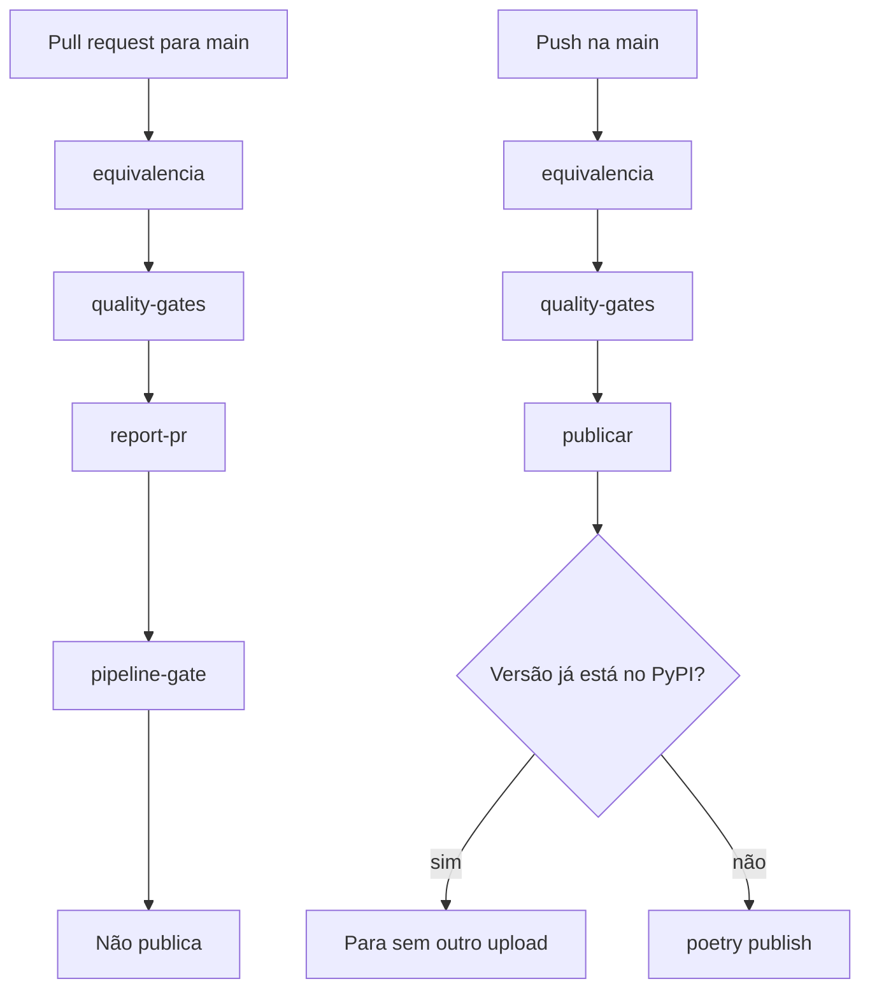
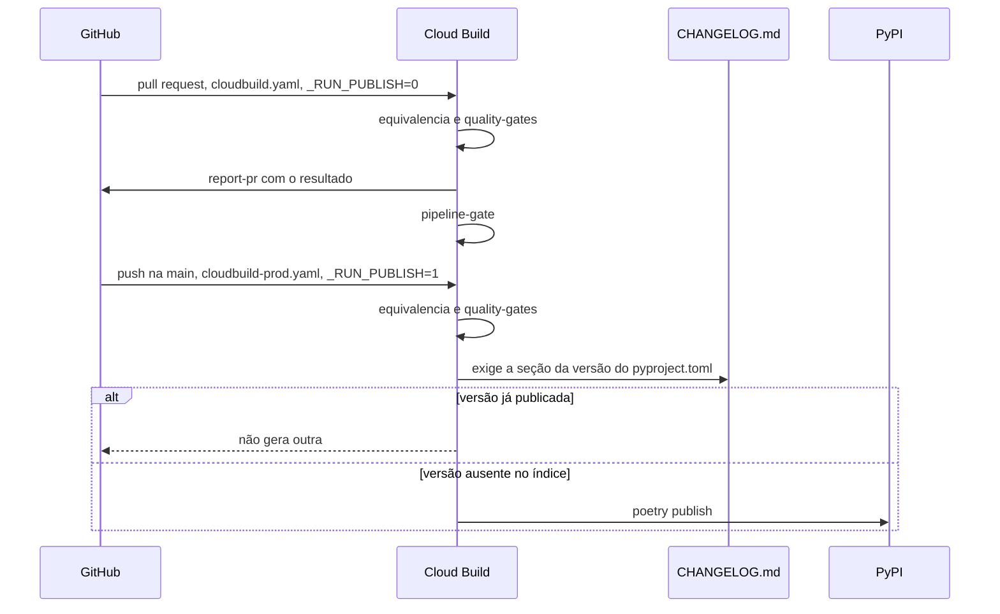
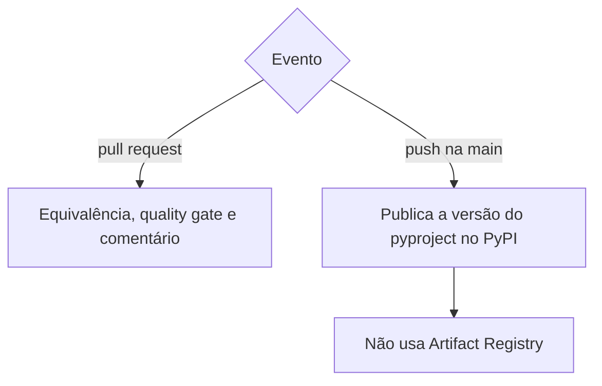

# Publicação da calculadora do Simples Nacional

Escopo: `cloudbuild.yaml` na pull request e `cloudbuild-prod.yaml` no push da `main`. A lib é pública. A única versão publicada é a do `pyproject.toml`, no PyPI. Não sobe para o Artifact Registry.

## Fluxograma

## Sequência

## Decisão

