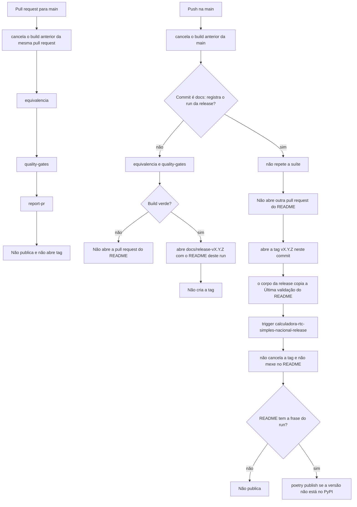
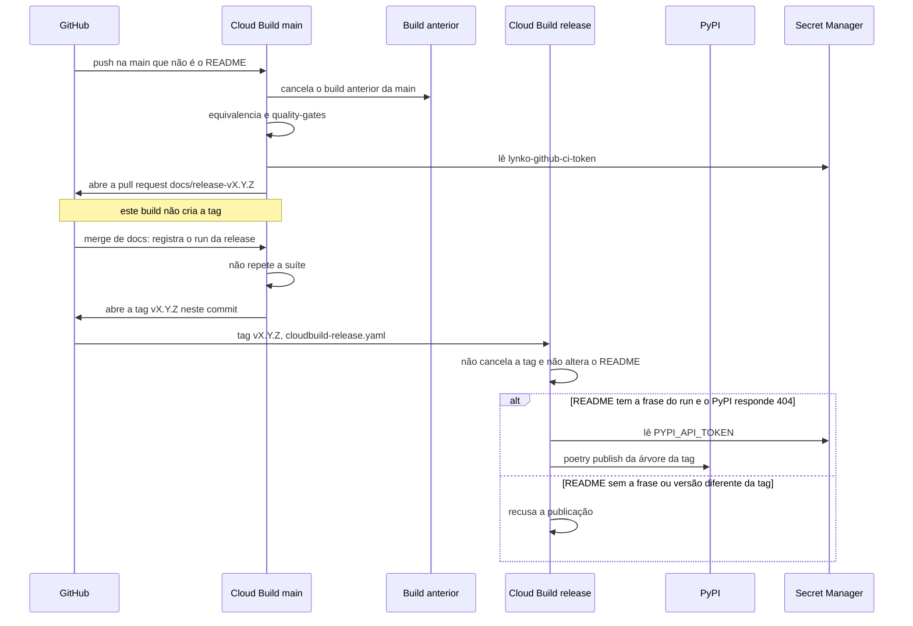
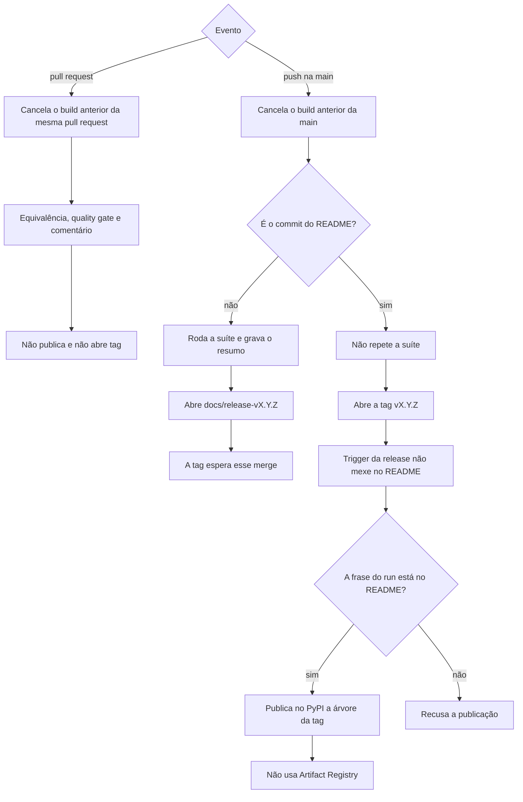

# Publicação da calculadora do Simples Nacional

Escopo: o push na `main` que ainda não é o commit do README roda equivalência e quality gates, grava o resumo desse run e abre a pull request `docs/release-vX.Y.Z` com o README preenchido. Não cria a tag. O merge do commit `docs: registra o run da release` não repete a suíte e abre a tag `vX.Y.Z`. O trigger da release não mexe no README: publica no PyPI a árvore da tag e recusa se o README não tiver a frase do run que validou a versão. Não sobe para o Artifact Registry.

## Fluxograma

## Sequência

## Decisão

Um commit novo na mesma pull request ou na `main` cancela o Cloud Build anterior. A tag não cancela. No build da `main` o passo de cancelamento recebe o ambiente `main`, porque `production` faria o script pular. O restante do build da `main` continua com o rótulo `production` para o comentário da pull request.

O trigger da release não escreve na `main`. A seção Última validação entra na pull request `docs/release-vX.Y.Z`, com os números da esteira do merge que rodou a suíte. A tag nasce do merge desse commit e o corpo da release copia essa seção e o bloco da release. Sem a frase `o run que validou esta versão` no README da tag, a release não abre e o PyPI não recebe o pacote.

O passo `report-pr` está no `cloudbuild.yaml`. A imagem `cloud-sdk:slim` não traz `python3`, então o passo instala. O comentário lê o secret `lynko-github-ci-token`. No build `734e3d4d` o script não achou o `python3` e o GitHub respondeu 403. Sem Issues: Write neste repositório, o passo não comenta e o `pipeline-gate` segue. A pull request do README e a tag precisam de Contents: Write no mesmo token.
