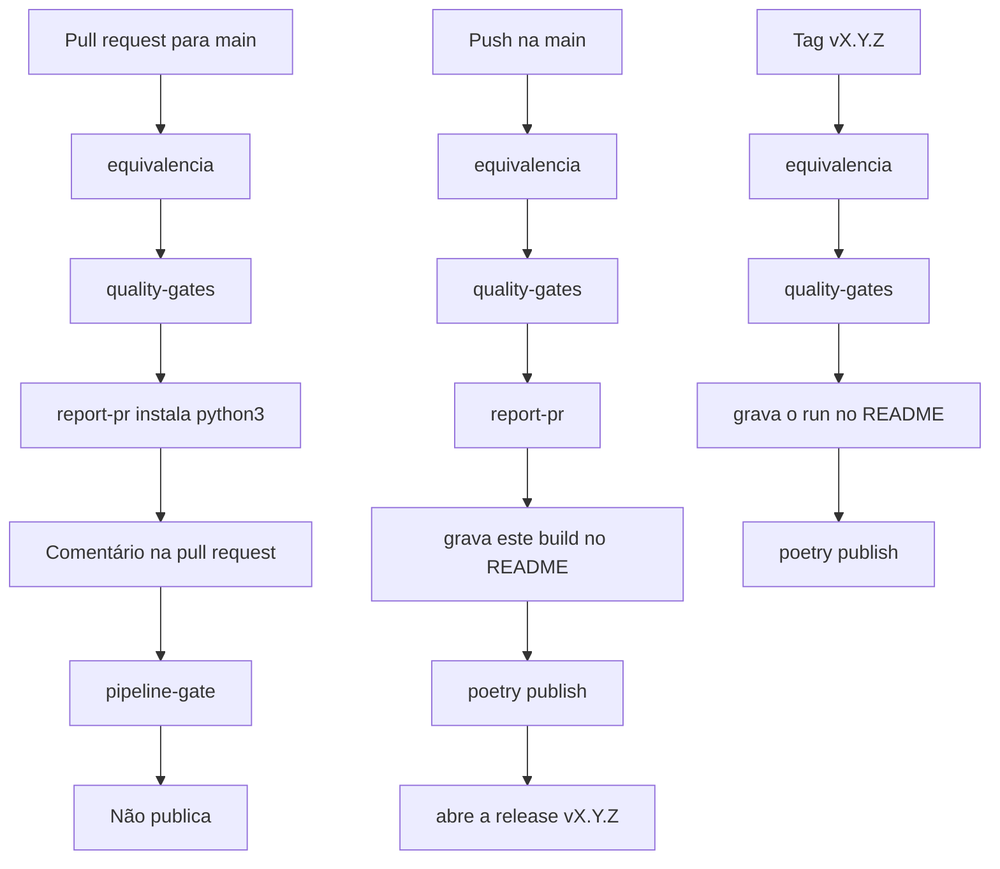
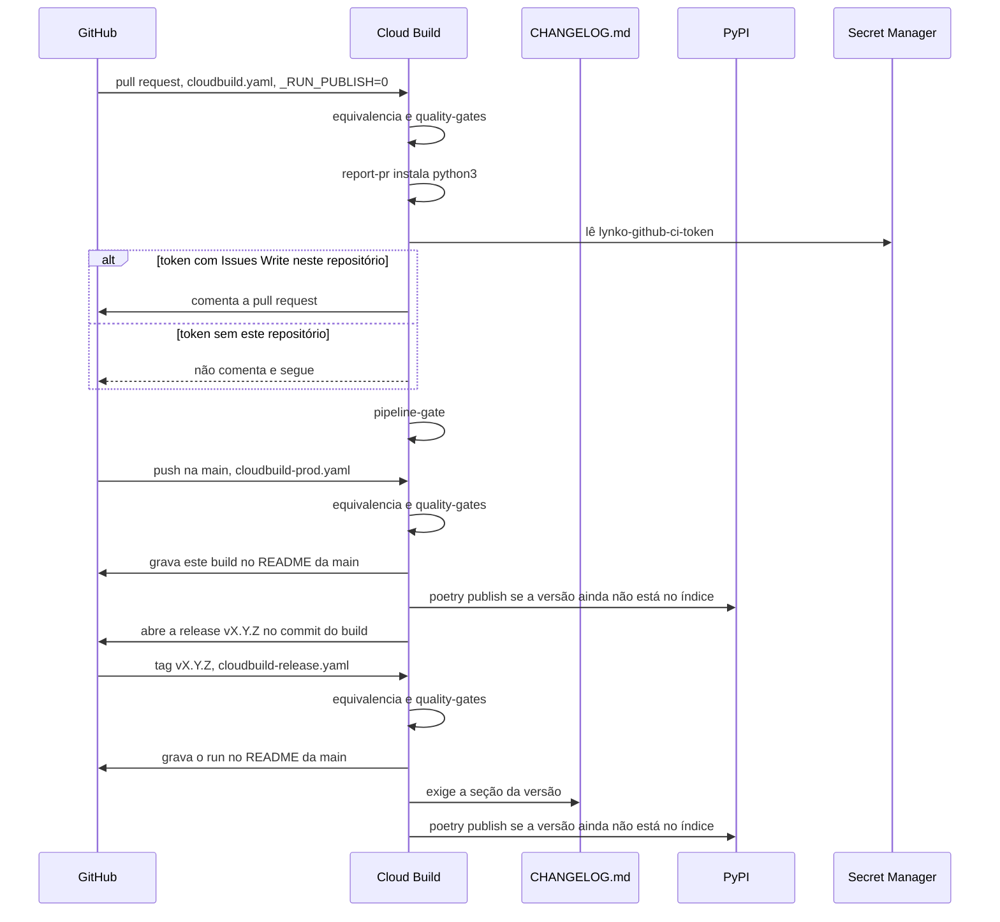
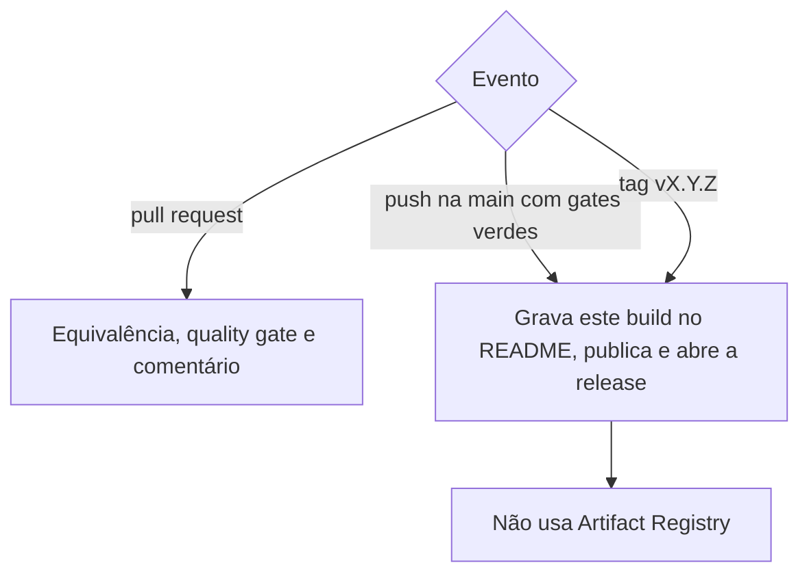

# Publicação da calculadora do Simples Nacional

Escopo: o push da `main` faz o build da lib. Se a versão é nova, abre a release `vX.Y.Z`. Essa release grava o build da `main` no README e publica no PyPI. Não sobe para o Artifact Registry.

## Fluxograma

## Sequência

## Decisão

O passo `report-pr` está no `cloudbuild.yaml`. A imagem `cloud-sdk:slim` não traz `python3`, então o passo instala. O comentário lê o secret `lynko-github-ci-token`. No build `734e3d4d` o script não achou o `python3` e o GitHub respondeu 403. Sem Issues: Write neste repositório, o passo não comenta e o `pipeline-gate` segue.
